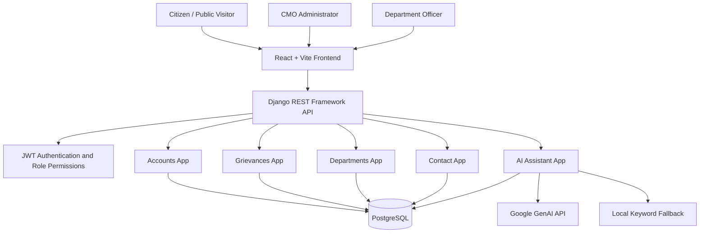

# 02 – System Architecture

## 1. Architecture summary
The application uses a React single-page frontend, a Django REST Framework API, PostgreSQL persistence and an external generative-AI service with a local fallback.

## 2. Main components
- **React/Vite frontend:** public pages, authentication forms, citizen dashboard, CMO dashboard and officer dashboard.
- **Axios API client:** central API base URL and JWT bearer-token attachment.
- **Django REST Framework:** REST endpoints, serializers, validation and role-based authorization.
- **Accounts app:** custom user model and role information.
- **Grievances app:** grievance records, attachments, status history, assignments, action reports and feedback.
- **Departments app:** department reference data.
- **Contact app:** public contact-enquiry persistence.
- **AI assistant app:** AI analysis and human review endpoints.
- **PostgreSQL:** relational storage.
- **Google GenAI:** external model integration; local fallback may be used when the service is unavailable.

## 3. Architecture diagram

## 4. Request flow
1. A user interacts with the React interface.
2. Axios sends an HTTP request to the configured API base URL.
3. Protected requests include a JWT access token.
4. Django validates authentication and role permissions.
5. Serializers validate and transform request data.
6. Views execute application logic and persist changes to PostgreSQL.
7. The API returns JSON; the frontend updates the relevant screen.

## 5. Security boundaries
- Backend authorization is authoritative. Frontend route guards are only a user-experience feature.
- Citizens must only access their own grievance records.
- Public tracking must return only public fields and public history.
- Internal remarks must not be exposed to citizens or anonymous visitors.
- Uploaded files must be type/size validated and served safely.
- Secrets belong in environment variables and must never be committed.
- Production deployment must use HTTPS, restricted CORS/hosts and `DEBUG=False`.
