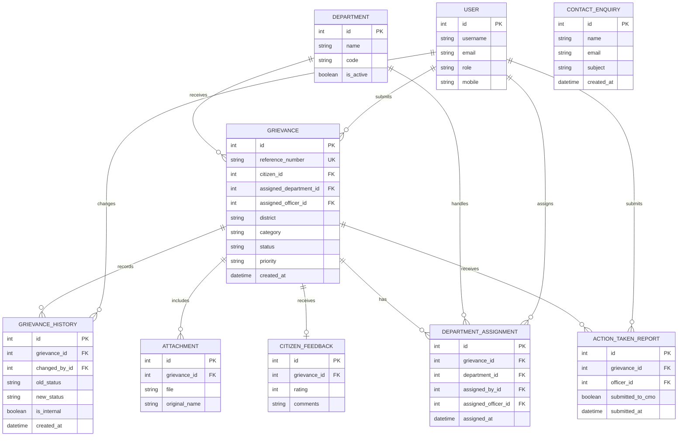

# 03 – Database Design

## 1. Overview
The database is relational and uses PostgreSQL. The Django models are the source of truth; confirm exact field names and constraints against the current migrations before treating this document as a schema dump.

## 2. Main entities

### User
Custom Django user extending `AbstractUser`.
- Standard username/password/name/email fields.
- `role`: `CITIZEN`, `CMO_ADMIN` or `OFFICER`.
- `mobile`: optional mobile number.

### Department
- `name`
- `code`
- `description`
- `is_active`
- `created_at`

### Grievance
- `reference_number` (unique public identifier)
- `citizen` (User relationship)
- `district`, `category`, `subject`, `description`
- `status`, `priority`
- `assigned_department`, `assigned_officer`
- AI suggestion fields: department, category, priority, summary, analysis JSON and review flag
- `internal_remarks`
- `created_at`, `updated_at`, `due_at`

### GrievanceHistory
- `grievance`
- `old_status`, `new_status`
- `changed_by`
- `remarks`
- `is_internal`
- `created_at`

### DepartmentAssignment
- `grievance`
- `department`
- `assigned_by`
- `assigned_officer`
- `remarks`
- `assigned_at`
- `is_active`

### Attachment
- `grievance`
- `file`
- `original_name`
- `uploaded_at`

### ActionTakenReport
- `grievance`
- `officer`
- `investigation_details`
- `action_taken`
- `resolution_details`
- `submitted_to_cmo`
- `submitted_at`

### CitizenFeedback
- `grievance` (one-to-one relationship)
- `rating`
- `comments`
- `created_at`

### ContactEnquiry
- `name`
- `email`
- `subject`
- `message`
- `created_at`

## 3. Entity relationship diagram

## 4. Integrity and privacy
- Reference numbers must be unique.
- A citizen feedback record should be limited to one per grievance if the model uses a one-to-one relation.
- Feedback should only be accepted from the grievance's citizen after resolution.
- Citizen-facing history must exclude internal entries.
- Foreign-key deletion behaviour should be reviewed before production.
- Confirm exact nullability, indexes, ordering and `on_delete` behaviour from Django model definitions and migrations.
